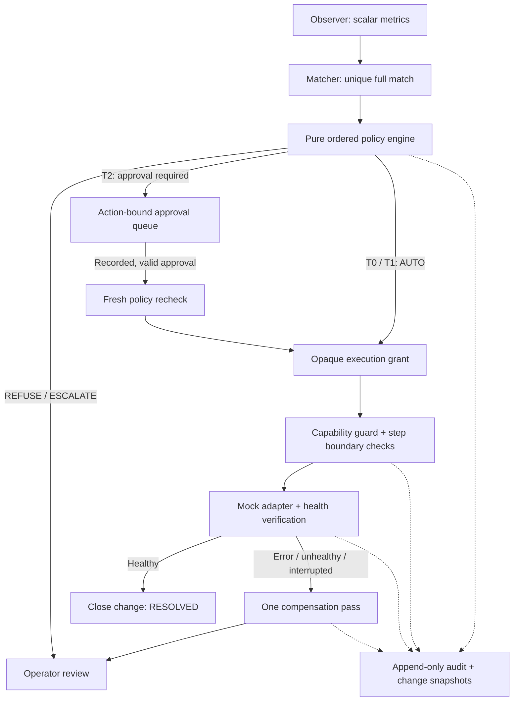

# AegisOps

A policy-gated runbook remediation engine for AO-04: **automation that is safe enough to leave switched on**. Python 3.11+, Flask, SQLAlchemy/SQLite, PyYAML, Jinja2, and vanilla JavaScript. No frontend build and no Docker required.

**This deliverable is a working simulation.** The supplied ZIP contains eight synthetic CSV files, not the organizer YAML, S01–S13 scenarios, Docker environment, or fault injector referenced in the task. Original files are preserved byte-for-byte in `data/source_csv/`. The ten runbooks, policy, and thirteen scenarios used here are newly authored demo fixtures and prominently labeled. Passing these tests does **not** establish compliance with missing organizer ground truth. See [input provenance](data/PROVENANCE.md).

## Run locally

From the extracted `aegisops/` directory:

```bash
python -m venv .venv
# Linux / macOS
source .venv/bin/activate
# Windows PowerShell instead: .venv\Scripts\Activate.ps1
python -m pip install -r requirements.txt
python -m pytest -q
python scripts/demo.py
python scripts/http_smoke.py
```

Start the dashboard:

```bash
# Linux / macOS: generate a token and keep it available to unlock the dashboard
export AEGISOPS_OPERATOR_TOKEN="$(python -c 'import secrets; print(secrets.token_urlsafe(32))')"
export AEGISOPS_APPROVER="nikhil-on-call"
echo "$AEGISOPS_OPERATOR_TOKEN"
flask --app aegisops.web.app run --host 127.0.0.1
```

Windows PowerShell:

```powershell
$env:AEGISOPS_OPERATOR_TOKEN = python -c "import secrets; print(secrets.token_urlsafe(32))"
$env:AEGISOPS_APPROVER = "nikhil-on-call"
$env:AEGISOPS_OPERATOR_TOKEN
flask --app aegisops.web.app run --host 127.0.0.1
```

If `flask` is not on PATH, use `python -m flask --app aegisops.web.app run --host 127.0.0.1`. Open http://127.0.0.1:5000, click **Unlock controls**, and enter the token. It is kept in tab-scoped session storage. Without a server token, the dashboard remains read-only. Each approve/deny request records the operator identity configured on the server; the browser cannot impersonate another approver through its JSON body.

On the Overview page, inject `log_full` and run detection. Next inject `cert_expiring`, run detection, open Approvals, enter a reason, and select **Approve & execute** or **Deny**. Toggle the kill switch, run detection again, and inspect the refusal in Audit trail. The scripted demo adds failing-health and mid-run kill cases.

```bash
python -m aegisops --fault log_full --dry-run
python scripts/demo.py --dry-run
```

Dry runs record the decision and plan, with no approval creation, execution reservation, or adapter action. CLI/demo databases are ephemeral. The Flask dashboard persists event history in `aegisops.db`; mock environment state is intentionally in memory.

## Architecture



`policy.decide(candidate, observation, context)` performs no I/O. Checks stop at the first failure: kill switch, circuit breaker, match/confidence/unknown state, T3 prohibition, blast radius, global rate limit, and tier approval rule. The returned `Decision` is evidence, not an execution credential. `PolicyAuthority` re-evaluates the decision and issues an opaque grant bound to action ID and the hash of the exact runbook. The executor verifies that grant and the entire plan's capabilities before the first adapter action.

The condition parser accepts a named scalar metric, one comparison (`==`, `!=`, `>`, `>=`, `<`, `<=`), and a quoted string, boolean, or numeric literal. It never calls `eval`. YAML rejects duplicate keys, unknown schema fields, shell/command fields, invalid paths, missing capabilities, and mutating T3 definitions. `None`, nonfinite values, missing fields, and type mismatches produce UNKNOWN. Any partial match, multiple full matches, or required unknown value prevents execution. All known runbooks participate in matching; an unrelated unknown conservatively blocks automation too.

Before each forward step, the executor re-observes state, checks kill switches and approval validity, compares state with its previous authorized snapshot, re-matches the registry, and runs policy again. Known changes made by the previous successful adapter step become the new expected state. Unexpected changes abort. The final verification boundary also checks kill/revocation/state. No LLM is involved; there is no shell-string execution path.

## Safety evidence

| Success criterion / invariant | Implementation and exercised evidence |
| --- | --- |
| Resolve faults without unsafe actions | Bounded action/target/path allowlists; total bytes and restarts; replica ceiling; `test_policy.py` and every scenario's explicit unsafe-call assertions |
| Escalate ambiguous cases | Full/partial matching, unknown propagation, confidence floor; logs + core case S03, unknown case S13, cold-run ambiguity test |
| Roll back ineffective fixes | Recorded per-step receipts, one reverse compensation pass, restoration verification, then escalation; S07 and demo case 5 |
| Separate deciding from doing | Pure decisions plus opaque action/plan-bound grants; forged and modified-plan grants rejected |
| Fail closed | Missing input, observer error, missing runbook, low confidence, stale state, unapproved action and malformed schema all stop execution |
| T3 never mutates | Loader rejects mutating T3 definitions; policy refuses them; executor independently refuses T3 entry; observation context is retained for human review |
| T2 approval record and timeout | Approver/name, timestamp, reason, frozen plan and observation, action ID, incident ID, deadline; no approval reuse; expiry appends `DENIED_TIMEOUT` and an escalated change |
| Preconditions before every step | Declared read-only preparation followed by changed state or kill; S08/S09 and invariant 5; post-mutation revocation test |
| No retry loop | Every execution reservation is durable; a runbook cannot be attempted again for the same incident, including through a second pending approval |
| Complete audit trail | Every decision and forward/rollback event appends audit and change snapshots in one DB transaction; `check_complete` and dashboard completeness badges |
| Least privilege | A distinct `ScopedCredential` exposes only each runbook's declared action/target/path and numeric bounds; guard rejects every out-of-scope call |
| Tested kill switch | `/etc/automation/KILL`, `AUTOMATION_KILL`, and persisted dashboard control; file/env ON cannot be cleared by dashboard OFF; tests cover all three |
| Rate limits and circuit breaker | Durable execution reservations count against a rolling global budget; consecutive failures open the breaker until its reset window; unfinished executions quarantine later actions |
| ITIL-style change records | Stable change ID/start, requester, approver, standard (T0/T1) / normal (T2), assessment (T3/unmatched), close time, outcome and rollback result; append-only snapshots |
| Data-driven holdouts | Three inline runbooks absent from the shipped registry: swap refresh, zombie cleanup and expired-token rotation. New resource names are explicitly added to policy data; engine code is unchanged |

The test files map directly to the requested loader, policy, scenario, invariant, and holdout requirements. `test_safety_edges.py` additionally checks false rollback-success claims, external-writer conflicts, post-mutation adapter exceptions, durable incomplete-execution quarantine, duplicate YAML keys, grant tampering, and approval reuse through parallel pending requests. See `docs/validation.json` and `docs/demo-output.txt` for this build's verification evidence.

## Policy data and simulation semantics

The authored registry contains log cleanup (T1), core-dump preservation (T3), isolated worker restart (T1), bounded queue scaling (T2), certificate rotation (T2), temporary cleanup (T0), replication diagnostics (T3), isolated pool recycling (T2), deployment compensation (T2), and DNS-cache refresh (T1). These do not claim to reconstruct the absent organizer runbooks or to reproduce the CSV policies.

The mock adapter executes typed operations and applies each step's `simulation_effects` to in-memory metrics. It tracks every adapter call, the state before that call, and the runbook identity. Effects are **simulation fixture metadata**, not instructions for live infrastructure. Receipts preserve values changed by the operation. `restore` compensation restores only those values and verifies them. An outside writer changing an affected value prevents compensation rather than allowing rollback to overwrite that writer's state; the outcome remains ESCALATE with rollback FAILED. Failure injection can suppress forward effects or force rollback failure. No historical CSV approval ever authorizes execution.

Safer choices where the task is ambiguous:

- Compensation can run while the kill switch is ON or approval is revoked, because aborting a completed fix must remain recoverable. It uses only predeclared restore capabilities; no new remediation is authorized.
- T3 gathers context through the observer and records operator escalation. No runbook mutation is attempted. Paging is represented by the refusal/escalation record and dashboard; no external notification is sent.
- A pending request is consumed only once. Timeouts/revocations prevent further steps; consumed approvals remain subject to expiry until the execution closes.
- Audit/change tables and approval/runtime events reject SQL UPDATE and DELETE with SQLite triggers. New snapshots capture transitions; there are no edit/delete API routes.
- Any unfinished execution found after restart opens the breaker indefinitely. There is no automatic retry or automatic unsafe recovery. An operator must investigate and deliberately start a fresh simulation database when appropriate.

## API

GET endpoints are read-only views (and process overdue approval deadlines). All POST requests require `Authorization: Bearer <AEGISOPS_OPERATOR_TOKEN>`, JSON content, and same-origin access when an Origin header is present. The application does not use cookie authentication for control requests. Supply a nonempty reason for human decisions. Server configuration determines the recorded approver identity.

| Method | Route | Body / behavior |
| --- | --- | --- |
| GET | `/api/status` | Observations, active actions, approvals, kill state, breaker, rate window |
| GET | `/api/audit` | Audit records with completeness and change snapshots; optional `action_id`, `runbook_id`, `tier`, `final_outcome` filters |
| POST | `/api/inject` | `{"fault":"log_full"}` or a list of known fault names for combined faults; simulate only |
| POST | `/api/run` | `{}` or `{"dry_run":true}`; synchronous detection cycle |
| POST | `/api/approve/<id>` | `{"reason":"Reviewed staging scope"}`; record approval, recheck and execute |
| POST | `/api/deny/<id>` | `{"reason":"Unsafe timing"}`; deny pending request or revoke approved/consumed request |
| POST | `/api/killswitch` | `{"enabled":true}` or `false`; only changes the dashboard source |

```bash
curl -X POST http://127.0.0.1:5000/api/inject \
  -H "Authorization: Bearer $AEGISOPS_OPERATOR_TOKEN" \
  -H 'Content-Type: application/json' -d '{"fault":"log_full"}'
curl -X POST http://127.0.0.1:5000/api/run \
  -H "Authorization: Bearer $AEGISOPS_OPERATOR_TOKEN" \
  -H 'Content-Type: application/json' -d '{}'
```

Configuration: `AEGISOPS_DATABASE_URL` (SQLite URL), `AEGISOPS_OPERATOR_TOKEN`, `AEGISOPS_APPROVER`, `AEGISOPS_KILL_FILE` (default `/etc/automation/KILL`), and `AUTOMATION_KILL`. Nonempty unknown kill environment values are treated as ON. `AEGISOPS_MODE` defaults to `simulate`; setting a live mode raises an error. The demo uses injectable clocks for deterministic timeout tests.

## Limitations

- **Missing authoritative inputs:** original organizer policy/runbooks/scenarios and Docker environment must be obtained before claiming judge-scenario compliance. The 3,000 historical synthetic incidents are preserved as reference data, not treated as test ground truth or evidence of safe real actions.
- **No live Docker backend:** the optional adapter deliberately raises an error. A Docker socket is broad host authority and would contradict per-workload least privilege without an independently enforced backend. No Docker environment was invented and no real infrastructure was modified.
- **Application-level capabilities:** Python guards demonstrate least privilege in the simulation. They are not an OS sandbox against hostile Python adapters. A future live backend requires workload-enforced credentials, resource identity checks, and actual reversible operations.
- **Local, single-process operation:** an engine lock serializes detections and approval execution; an approval lock serializes decision transitions, while kill/revoke remain available during execution. Multiple application processes sharing a DB are unsupported. Use one local Flask process and do not enable the debug reloader. Production deployment would require transactional distributed reservations and real identity/role verification.
- **Mock state is not durable:** audit/approval/control events persist in the dashboard DB, but state and receipts do not survive a crash. Unfinished executions halt subsequent actions. Crash recovery and durable physical snapshots are not implemented.
- **Boundary-based stopping:** a running step is not interrupted halfway through. Health verification is bounded and does not retry remediation, but no general watchdog can cancel a hung adapter. Exact observation comparison is intentionally conservative and may escalate benign asynchronous changes.
- **Approvals are local:** a configured bearer token identifies one configured operator. This is not enterprise identity verification or separation of duties. Pending requests expire when a cycle/status/page/approval check runs; there is no unattended expiry daemon. No external paging/ticketing integration is included.
- **Audit integrity is local:** triggers prevent ordinary UPDATE/DELETE, but a privileged process with DB-file access can remove triggers or replace the file. This is not a cryptographically sealed remote audit service. If storage itself fails, the engine stops forward actions and attempts compensation; it cannot guarantee writing a record to unavailable storage.
- **Packaging:** run from the extracted source root so bundled `data/` files resolve. This project is delivered as a source archive, not a standalone executable or deployed service. Server rendering, assets and control flows were tested through Flask and real HTTP. Visual browser rendering could not be verified because the browser download was unavailable.

Development commits follow the requested staged build. Inspect `git log --oneline` in the bundled repository.


## Phase 2 frontend refresh

The dashboard now uses a custom dark operations-console design across Overview, Runbook Registry, Approval Queue, and Audit Trail. The refresh keeps the existing Flask/Jinja routes and JSON API contracts, preserves the operator-token control flow, and adds responsive layouts, a mobile navigation toggle, clearer simulation/provenance labeling, improved telemetry cards, approval evidence panels, audit completeness bars, and a more legible decision output terminal.

No frontend build step is required. CSS and JavaScript are served locally; no external font or UI framework is required. The interface remains a **simulation UI** and does not enable live infrastructure execution.
